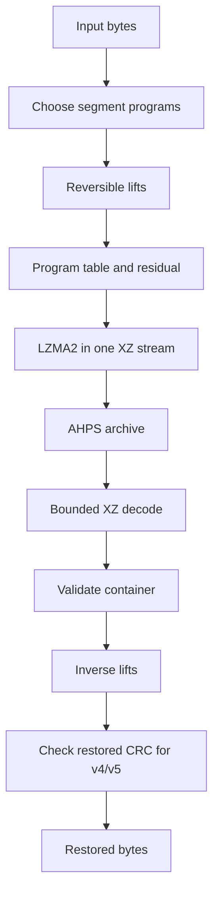

# AHPS technical retrospective

November 1, 2026. Historical technical review.

**Reviewed by the core and benchmark reviewers. Software snapshot: `b90340b`.**

> Historical development evidence. The narrative and measurements below describe
> the November 1 snapshot. Local source PDFs, corpus files, archived binaries, and
> raw records may be absent from the public checkout. The
> [documentation index](index.md) connects this history with later results.

## Changes through November 6, 2026

| Area | Current implementation | Evidence and limits |
| --- | --- | --- |
| Ordinary AHPS | Reversible binary transforms in v5 with a Python implementation and optional C/AVX2 acceleration | Original x86 and structured-data measurements below retain their recorded scope |
| CSV | Opt-in `--csv` compares a byte-exact column-grouped v6 candidate with ordinary AHPS | One development CSV improved at both tested presets. [CSV results](../reports/csv-compression.md) |
| Safetensors | Opt-in `--safetensors` uses exact F32 precision elision and FP8 magnitude rANS coding in v7 | Inputs are capped at 32 MiB. Three 15 MiB slices improved, saving 2.16% against earlier AHPS. [Tensor results](../reports/safetensors-aware.md) |
| Terminal progress | Automatic TTY display plus `--progress` and `--no-progress` | Stage-based percentages, elapsed time, and activity display. [Validation](../reports/terminal-progress.md) |
| Single-file benchmarking | `bench INPUT --ahps-only` runs AHPS with round-trip verification | Omitting the flag also runs gzip and XZ comparisons |
| File decoding | v4/v5 segments stream through the file API, while v3/v6/v7 buffer their complete containers | Output replacement follows validation. [Current format and limits](format.md) |

The November 3 profiling and decoder-memory experiment are complete. The tested
memory change missed its acceptance criteria and was rejected. The PAQ pilot
stopped at its feasibility gate. Separate relational and independent-backend
experiments have recorded positive and negative development results. Their
status appears in the [task history](next-steps.md). Final independent evaluation
and broader claims remain unresolved.

The rest of this document preserves the earlier review, including its historical
test counts, recommendations, and measurements.

## November 1 snapshot

At this snapshot, AHPS was a tested preprocessor for LZMA on x86 and structured binary data. On `blender.exe` (113 MB) it was 3.34% smaller than 7-Zip BCJ2, at 3.26x BCJ2's encode time and 4.92x its decode memory.

The strongest transform evidence comes from choosing and chaining reversible transforms for structured regions. Several other wins used RAW preprocessing, so they can't be credited to transforms. The original generator thesis has shown no material benefit on real files: a historical census of 745 MB found no hits for its 16-bit LCG, word-LCG and GF(2)-linear detectors. POLY2 and known tables gave small gains, and the striking generator result was a planted synthetic stream.

| Working target against BCJ2 | Measured so far | Status |
| --- | --- | --- |
| At least 2% smaller on 8 of 10 sealed x86 files, none over 1% larger | 3.34% smaller on Blender | Not evaluated: sealed files are untouched |
| Encode time at most 3x (geometric mean) | 3.26x on Blender | Just above on the one file timed |
| Decode peak at most 2x (geometric mean) | 4.92x on Blender | Well above; the largest open gap |

We recommend profiling and reducing decoder memory next, then adding controls and wider x86 evidence, then freezing the design and opening the sealed holdouts once. Only two real x86 programs have tested the current search, so no general x86 claim is justified yet.

## How this started

AHPS began with a question about what low-level code can do, not with a compressor. The maintainer asked whether C or assembly could produce output Python could not, then narrowed that to compression and proposed brute-force next-character guessing. The discussion that followed compared four paradigms: dictionary and entropy coding, context mixing, neural prediction, and program synthesis.

Enumerating every possible fixed-length output and storing its full index creates no general compression advantage. The proposed alternative was to search a restricted family of short descriptions, and keep one only when its program, parameters and residual beat the baseline encoding. Synthetic generated streams showed this was possible, not how often useful descriptions occur in real files.

The write-up closed with the proposal that gave AHPS its name, Asymmetric Hybrid Program Synthesis: use a fast heuristic to find tiny deterministic programs that generate segments of a file, then store each program with its coded residual. Search would be expensive once, and decoding would stay cheap. These were hopes at that stage, not measured results.

The project then moved from that thesis toward what the data supported:

1. **First review.** By then the prototype had moved from tiny independent blocks to a control tape, a CLI and a C/AVX2 bridge. Its 16.93x headline came from test data shaped around its own opcodes. Two serious bugs were fixed: a wrong PRNG inverse (51749 instead of 35581), and crafted archives that could crash the native decoder.
2. **Compressor v2.4.** Chained programs across many blocks arrived, and the planner gained a whole-file x86 trial. Stable segmentation and `delta -> split` chains became useful on structured telemetry; later controlled MR and X-ray removals quantified the chain's contribution.
3. **Generator census.** A dedicated census tested the thesis on 9 files and 745 MB, and reported no hits for its 16-bit LCG, word-LCG and GF(2)-linear detectors. POLY2 hits and known tables saved 21,876 B in total, about 0.004% of the 547 MB `xz -1` output, and 25 of 26 POLY2 hits were plain linear ramps.
4. **v2.5.** The main developer added `EXE_SPLIT` and a ModRM predicate. Code-section experiments motivated further executable preprocessing work, followed by whole-file comparisons with stronger baselines.
5. **Testing against real rivals.** Silesia and 7-Zip BCJ2 replaced easier baselines. An earlier installer comparison shrank to a 0.11% lead once `xz` with BCJ replaced plain `xz`. Separately, 1 MiB sampling and cheap whole-file trials mis-ranked Blender's plans above 16 MiB. That diagnosis should not be used to explain the installer result without a rerun.
6. **Per-chunk planning.** A 15 MiB chunk test on `blender.exe` found that one whole-file plan could not suit both code and data. That change put AHPS ahead of BCJ2.
7. **Two-agent plan.** The core reviewer and the benchmark reviewer agreed five gated steps: dependability, component experiments, search cost, freeze, and one final evaluation. Dependability passed its bounded checks. Component and search experiments gave useful results, but their full gates remain incomplete. The freeze and final evaluation have not happened.

The benchmark reviewer checked this history against the local sources `how_this_started.pdf` (132 pages) and `latest_update.pdf` (5 pages). PDF page references: original questions and proposal, how\_this\_started pp.1-12; native and file tooling, pp.23-38; the v2.4 review and census, pp.89-90; `EXE_SPLIT` development, pp.99-100 and 125-132; whole-file and chunk selection, latest\_update pp.1-4. These figures are historical reports, not reruns, and the synthetic 17x to 48x self-test ratios are not product evidence.

## How AHPS works

AHPS rewrites data into a form LZMA compresses better, and stores the rewriting steps beside the result. Each rewrite, called a lift, keeps the data the same length and can be reversed exactly, so decoding never searches.

Fast estimates propose plans, and real LZMA2 trials rank the finalists. LZMA2 also compresses the final container, so RAW means no AHPS preprocessing, not uncompressed storage. The final stream stays solid across chunk boundaries. This is a constrained search over transform programs, not over arbitrary executable programs.

A segment's program is up to three lifts, and each lift is one opcode with four parameter bytes. The lifts fall into three families:

- **Structured data.** `DELTA1`, `DELTA2` and `SPLIT` subtract repeated strides and separate byte lanes.
- **x86 code.** `EXE32` rewrites relative call targets as absolute ones in place. `EXE_SPLIT` also moves those targets to a table at the segment's end. A preceding-byte heuristic tries to avoid false call matches. It is not a complete instruction decoder and can exclude genuine calls.
- **Generators.** `POLY2` and `XORSHIFT16` remain from the original thesis, but real files barely use them.

The C/AVX2 kernel accelerates scoring and the reversible transforms, with matching Python implementations. LZMA2 itself comes from Python's liblzma-backed module, so native acceleration does not remove the cost of repeated LZMA trials. Tests compare the native and Python results, and an unsupported ABI or CPU selects the Python path.

## What we achieved

AHPS went from an unversioned prototype to a versioned format with enforced decoder limits, 182 passing tests and repeatable benchmarks. Everything below is at `b90340b` or an earlier reviewed commit named in the appendix.

**Dependability.**

- New archives use format v5, ABI 206, with a written contract in [docs/format.md](format.md). The reader still validates v3 and v4. For v4 opcode `0x09`, only the later `EXE_SPLIT` meaning is supported. Earlier archives of that kind need the tool that wrote them, though some inputs happen to transform identically. CRC does not identify a format, and the reader never guesses another decoder.
- The decoder enforces limits on liblzma working memory, decoded container size and restored size, with early header checks and bounded XZ reads. It still accumulates the full container and restored output, so it is not a streaming decoder or a total process-memory cap. The CPU is checked before the AVX2 library loads.
- Fuzzing passed 1,000 cases in each of five campaigns, 60,000 `EXE_SPLIT` round trips, 21,000 malformed containers and 10,000 mutations, with no crash or engine disagreement. The core reviewer also reports additional runs with seeds 7741, 9182 and 3307; the counts above come from the committed reports. These bounded checks do not prove memory safety.

**Measurement.** Benchmarks run in fresh processes with kernel peak memory, source and tool hashes, verified round trips and pinned 7-Zip settings. The reporter rejects mixed commits, missing runs and unconfirmed search settings.

**Compression on Blender.** All sizes below are complete archives at preset 9.

| Configuration | Archive size (B) | Against BCJ2 (27,292,035 B) |
| --- | ---: | ---: |
| AHPS default | 26,380,608 | 3.34% smaller |
| Without `EXE_SPLIT` | 26,466,520 | 3.02% smaller |
| Without per-chunk planning | 27,770,972 | 1.75% larger |

These are size-only comparisons across commits: the default archive was reproduced under the reviewed core, while the removal rows came from later commits with recorded artifact identities. They are not paired timing controls. The effects overlap and can't be added. Removing per-chunk planning reverses Blender's result against BCJ2. `EXE_SPLIT` contributes about 9% of the size lead while `EXE32` remains available as a fallback.

**Other component results.** Removing delta-to-split cost 252,560 B (6.31%) on `x-ray` and 133,724 B (5.39%) on `mr`. In a separate whole-file transform test on Blender, removing the ModRM predicate added 114,884 B (0.414%), about 69% of `EXE_SPLIT`'s advantage over `EXE32` in that test. Those are residual XZ sizes, not complete archives, so they can't be added to the effects above.

**Search cost.** A diagnostic profile pointed to repeated LZMA trials as the cost to reduce. A size-only pilot found that cheap chunk trials alone cost 76,444 B on Blender. Combining them with removal of the extra whole-chunk `EXE32` rival gave an archive identical to exhaustive search. This combined method is Candidate A, and neither change has an independent share of the speedup. On 2026-11-01 the maintainer approved it as the automatic default only when the resolved final preset is 9 with EXTREME.

| Fresh Blender cohort, three repetitions each | Archive size (B) | Median encode s \[range\] | Median decode s | Median decode peak (MiB) |
| --- | ---: | ---: | ---: | ---: |
| Exhaustive AHPS | 26,380,608 | 180.958 \[178.444-181.780\] | 1.563 | 383.645 |
| Candidate A | 26,380,608 | 86.901 \[86.296-87.848\] | 1.531 | 383.602 |
| 7-Zip BCJ2 | 27,292,035 | 26.680 \[26.676-27.566\] | 0.619 | 77.922 |

Candidate A saved 51.98% of median encode time, a 2.08x speedup over exhaustive search, and all six AHPS archives had identical hashes. Against BCJ2 it took 3.257x the encode time and 4.923x the decode peak working set. Encode peaks were about 1,007 MiB for A and 707 MiB for BCJ2.

Only Blender has a fresh repeated comparison of these methods. Ratios divide method medians, and other development timings are single-run diagnostics. At preset 3, A produced 30,086,652 B against exhaustive's 30,073,892 B, a loss of 12,760 B (0.0424%), so preset 3 stays exhaustive. No decoder time or memory improvement was demonstrated.

The implicit large-file preset remains 3 with exhaustive search, and explicit search settings override the default. The benchmark harness always passes an explicit method, so an omitted `--search` means exhaustive even at preset 9. Those rows do not measure the new product default.

## What the evidence does and does not show

The evidence supports AHPS as a useful filter stack on two x86 programs and two data files. It does not yet support a general x86 claim or a claim of novelty.

**Well supported.**

- Per-chunk planning decides Blender's result against BCJ2.
- Delta-to-split is doing real work on `x-ray` and `mr`.
- Candidate A showed no size loss at preset 9 extreme across 15 development files: 14 identical archives, and `node` 12,420 B smaller (0.0576%). Nine of those small-file comparisons did not exercise chunk search.
- The established timing result is the 51.98% median reduction on Blender. Other timings are diagnostic only.
- Repeated runs of the tested configurations produced identical archive hashes. This does not establish reproducibility across platforms, versions or inputs.

**Weaker than it first looks.**

- **Silesia's headline.** AHPS totals 2.93% smaller than BCJ2 on nine development files, but an executable-oriented baseline alone can't explain wins on other data. Six of those nine ended as whole-file RAW, so AHPS applied no transform at all. Against the best rival per file, the earlier figure was 0.93%, and about 92% of that saving came from `x-ray` and `mr`.
- **NCI's 16.79%.** This is not a transform win, because its winning plan was RAW. Backend, settings and container differences need matched controls to explain the gap, and the controlled matrix has no plain XZ control.
- **Candidate A's coverage.** Nine of the 15 files are under 16 MiB, where the search does not run, so they prove nothing about it. Only six files tested it, and only Blender and `node` are real x86 programs.
- **Timing.** Only Blender has a repeated same-cohort search timing comparison. Every other time here is a single run.

**Not established.**

- **The generator thesis.** It worked on synthetic data, such as a 60 KB PRNG stream stored in 168 B. It has not worked on the real files tested. That does not disprove it, because the sample is small and the census has blind spots.
- **Novelty.** No systematic prior-art review has been done, so no novelty claim is made. A limited source check confirms that [ZPAQ](https://mattmahoney.net/dc/zpaq.html) stores decompression code in its archive format, and that [OpenZL](https://raw.githubusercontent.com/meta/openzl/dev/README.md) builds specialized compressors for a shared decompressor. Both are relevant comparisons, but calling either the closest prior art needs the broader review.
- **Why cheap trials lost bytes.** Changed chunk choices may affect matches across the solid stream, including where different x86 transforms meet. This explanation is untested.
- **What exhaustive means.** It means full-strength trials over the existing local candidates, not every whole-file combination. Candidate A beat it by 12,420 B on `node`, so local chunk ranking does not guarantee the smallest solid archive. Cross-chunk effects are a possible cause, not a measured one.
- **Safety and portability.** Fuzzing is bounded and is not proof of memory safety. All of this ran on one Windows AVX2 machine.

## Open questions at the November 1 snapshot

The largest gaps are decoder memory, the x86 instruction model and the LZMA back end. The first table lists missing controlled evidence or incomplete work, and some topics have exploratory history. The second records limited results and rejected versions, so they aren't mistaken for untested ideas.

**Not established or incompletely explored.**

| Area | What is missing | Why it matters |
| --- | --- | --- |
| Decoder memory | A measured profile of decoder buffers, then fewer copies or streaming decode | The largest gap: 4.92x BCJ2 on Blender |
| Final raw trial | An isolated, selectable raw-skip Candidate B with its own size-loss gate | It could remove work, but no controlled result shows its benefit or safety |
| Code recognition | Detecting code cheaply so fewer trials run at all | Part of the original Step 3 scope, not done |
| Chunk boundaries | Sizes other than 15 MiB, or boundaries at real code and data edges | Per-chunk planning is the biggest win, on one fixed size |
| Global search | Choosing chunks jointly, not one at a time | `node` shows isolated picks can miss a smaller archive |
| LZMA settings | Matched whole-stream parameter experiments | Current output is one XZ stream, and per-segment settings are not an existing API |
| Stream layout | Separate compressed streams, as BCJ2 uses | AHPS keeps one solid stream |
| x86 modelling | Splitting opcodes, ModRM and displacements, not only call targets | A hypothesis for further size gains, requiring cost and correctness checks |
| ModRM predicate | Comparison with a specified instruction-aware model | The byte heuristic's general precision is unmeasured |
| Other rivals | `zstd --ultra`, PPMd, PAQ, ZPAQ, cmix, neural compressors and dedicated media codecs | Only gzip, xz, zstd -19 and BCJ2 were compared |
| Controls | Plain XZ and tuned rivals in the same frozen cohorts | Needed to separate backend effects from transform effects |
| Interactions | Component combinations, and `EXE32` removal on real binaries | Step 2 ran narrower than planned |
| Other platforms | Linux, macOS, real non-AVX2 hardware, ARM64, ELF and Mach-O inputs | Validation used one Windows AVX2 host, the fallback was mocked, and no independent security audit is documented |
| Scale | Controlled multi-GiB behaviour, threading, streaming input and output | The file API holds complete inputs and outputs |
| Holdouts | Sealed Silesia files and 10 sealed x86 programs | Reserved for the one final evaluation |
| Prior art | A systematic literature and tool review | Novelty claims can't be made without it |

**Limited results, regressions and rejected versions.**

| Approach | Result |
| --- | --- |
| Custom context-mixing residual coder | 1.5 to 3.0% worse on block-switched residuals. 5.6 to 8.5% better on whole-file float and audio deltas, but at most 1.4% after chaining, at about 10 MB/s. Dropped |
| Tested generator detectors on real data | No 16-bit LCG, word-LCG or GF(2)-linear hits in the historical 745 MB census; small POLY2 and table gains remain |
| 1 MiB sampling for the plan picker above 16 MiB | Picked wrong plans; real trials replaced it |
| Cheap presets 1 and 3 for whole-file ranking | Mis-ranked Blender's plans |
| Cheap chunk trials that keep the `EXE32` rival | Cost 76,444 B on Blender |
| Candidate A at preset 3 | Cost 12,760 B on Blender, so preset 3 stays exhaustive |
| Extending the ModRM exclusion list | No change on the 32 MB sample and a 0.46% improvement on a small DLL; two binaries are too few to generalize |
| Single whole-file plans for mixed binaries | 1.75% larger than BCJ2 on Blender |

These failures have limits. Each was measured on specific files and settings, so none rules out a better version of the idea.

## Recommendations at the November 1 snapshot

We both put decoder memory first: profile it, then reduce it, before any large benchmark. Speed is close to target, memory is more than twice over it, and the holdouts can only be used once, so they come last.

Describe AHPS for now as an experimental filter stack for LZMA on x86 and structured binary data, not as a new compression method.

**The core reviewer's ranking.**

1. **Reduce decoder memory.** Profile decoder buffers first. The code appears to hold the full container and the full restored file together, but that is a reading of the code, not a measurement. Fewer copies or streaming may reach the 2x target, about 156 MiB on Blender against 384 MiB today, and EXE\_SPLIT and large segments may limit how far that goes.
2. **Run a prior-art search.** It costs little, and it decides what can honestly be claimed. It should cover at least ZPAQ, OpenZL, PAQ's x86 models and executable packers.
3. **Widen the x86 development set.** Add more real programs above 16 MiB, because only Blender and `node` have tested Candidate A. Those inputs must not come from the sealed lists.
4. **Test the raw-trial skip and add controls.** The withdrawn wrapper bundled several changes, so it gives no isolated timing or no-loss result for Candidate B. Add a plain XZ control at the same time, so backend and transform effects separate.
5. **Decide what else belongs before the freeze.** Tuning must happen before the holdouts are opened. A time-boxed look at x86 modelling and LZMA settings fits here, because either could add size gains.
6. **Freeze and evaluate once.** Fix the commit, compiler, settings and acceptance targets, then run the sealed Silesia files and the 10 sealed x86 programs. Report every file, including losses.
7. **Choose the future of the generator thesis.** Keep it as a separate research track aimed at data likely to contain generators, such as procedural assets, or close it. It should not hold up the filter stack.

**The benchmark reviewer's ranking.**

1. **Profile decoder buffers, then reduce copies.** Measure buffer lifetimes first, and separate the bytes-returning API from a file or stream API. Keep all structural, limit and CRC checks, and don't promise the 2x target before measuring.
2. **Complete attribution controls.** Run matched RAW, XZ and XZ with BCJ, the remaining component removals and a few interactions on development inputs, before inventing more transforms.
3. **Reduce remaining encode cost, one hypothesis at a time.** Start with planner ranking and code recognition, then a separate gated Candidate B if justified.
4. **Freeze a candidate and protocol.** Include the new automatic default against the harness's explicit-exhaustive default, plus the missing final-evaluation mode. Pin eligibility, reserves, settings and limits, then evaluate once, with no tuning after unsealing.
5. **Keep generator discovery separate.** Use targeted procedural or simulation data, planted positives and negative controls. Prior-art and platform validation are separate unfinished work.

**Where we agree and differ.** We agree on memory first, a freeze before any holdout, and generators as a separate track. We differ on what comes second. The benchmark reviewer wants attribution controls next, because six of nine Silesia winners were RAW, so transforms can't yet take the credit. The core reviewer wants prior art and more x86 programs next, because only two real programs have tested the current search and the novelty claim is unchecked. Both orders start with the same bounded task: a decoder-memory profile and design review, not a large benchmark campaign.

**Decisions for the maintainer.**

| Decision | Why it is needed | Core reviewer's recommendation |
| --- | --- | --- |
| Published metadata | The maintainer told the benchmark reviewer to take over, commit and push. `b90340b` included tracked local paths and the installed-app inventory, which persist in history | Check whether the repo is public, then decide whether to scrub them; a history rewrite needs its own authorization |
| Final acceptance targets | The 2%, 3x and 2x figures are still working numbers | Confirm them before the freeze |
| Research goal or product goal | They imply different stopping points | Treat the filter stack as the product and generators as research |
| More x86 development programs | Needed for step 3 of the ranking | Supply them from outside the sealed lists |
| Older `EXE_SPLIT` archives | Earlier v4 opcode `0x09` meanings are unsupported, though some inputs decode identically | Identify any archives that need recovery with their producing tool |
| Holdout eligibility rule | The largest `.exe` or `.dll` of at least 2 MiB is still a draft rule | Decide at the freeze |

## Appendix: evidence

The measurements in this retrospective come from the repository at `b90340b` and the frozen run commits below, on one Windows AVX2 machine, with Python, liblzma and 7-Zip identities recorded per run. Earlier figures come from the two local PDFs and keep their original limits. Those PDFs and some frozen artifacts are local research records.

| Topic | Source |
| --- | --- |
| Format contract | [docs/format.md](format.md) |
| Search defaults and how to reproduce them | [docs/search-methods.md](search-methods.md) |
| Dependability and fuzzing | [reports/dependability.md](../reports/dependability.md) |
| Evaluation rules (draft) | [reports/evaluation-protocol.md](../reports/evaluation-protocol.md) |
| Silesia development results | [reports/corpus-results-overview.md](../reports/corpus-results-overview.md) |
| Blender component checks | [reports/blender-components-overview.md](../reports/blender-components-overview.md) |
| Blender timing cohort | [reports/step3-search-results-overview.md](../reports/step3-search-results-overview.md) |
| Candidate A on the development corpus | [reports/step3-development-a-overview.md](../reports/step3-development-a-overview.md) |
| Preset 9 default validation | [reports/preset9-default-validation.md](../reports/preset9-default-validation.md) |

| Measurement settings | Value |
| --- | --- |
| Recorded preset 9 comparisons | Preset 9 extreme, block size 4096, format v5, ABI 206 |
| BCJ2 | `7z -t7z -mx=9 -md=64m -mf=BCJ2 -mmt=1 -ms=off` |
| Repeated Blender timing cohort only | Three fresh repetitions per method, alternating order, frozen commit `58b8058` |
| Candidate A | `SearchMethod(chunk_trial_preset=1, exe32_chunk_rival=False)` |

The preset 3 Blender check is a separate single-run pair, and must not be pooled with the preset 9 timing table. The 14-file preset 9 matrix is single-run size evidence at frozen commit `06e1033`. Final limits, eligibility and acceptance rules await the freeze.

The tuned `xz` delta comparison and the 0.93% best-rival figure are older measurements, not part of the frozen cohorts. Earlier measurements came from concurrent runs, so their timings should not be compared with the cohort above. Peak memory figures are kernel peak working set.
